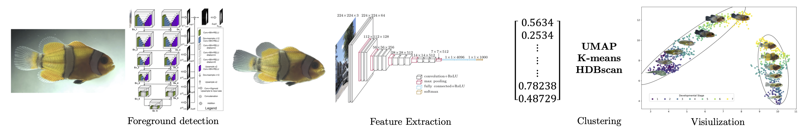

# DEEPFIN – Unsupervised Clustering of Fish Images

<p align="center"></p>


DeepFin is an end-to-end, fully reproducible pipeline that

1. Removes image backgrounds with **rembg** python package
2. Extracts high-dimensional feature vectors with the **EfficientNet V2-L** imagenet pretrained model architecture
3. Dimensional reduction using **UMAP**  
4. Morpho-visual clustering using **HDBSCAN** or **k-means**  
5. UMAP embedding scatter plot visualization (optional thumbnails)  

The approach is data-source agnostic and was validated on both novel anemone fish images and the public fish images data sets. The sample images are of Acipenseridae and Tinca Tinca fish species from the AFFiNe | Angling Freshwater Fish Netherlands database.

### Interactive demo of closely related anemone fish images

[Live interactive scatter plot](https://alexandru-mihai-94.github.io/deepfin_clustering/scatter_test.html)

### Interactive exhibit: how an AI sorts clownfish

[Open the exhibit](https://alexandru-mihai-94.github.io/deepfin_clustering/): three touch-friendly activities built
from the study's data. Tell *A. percula* from *A. ocellaris*, stage baby *A. ocellaris*, and build a classifier
without training data. It also runs offline as a home-screen app on an iPad, for science exhibits.
The pages are in `docs/`; the data behind them is made by the scripts in [`site_build/`](site_build/README.md).

---

## Sort your own images: no coding needed

DEEPFIN comes with a point-and-click app. You choose **a folder of images**, **a neural network** that turns each
image into a fingerprint of numbers, **a map method** (UMAP or PCA) and **a grouping method** (HDBSCAN or k-means),
and it sorts the images into groups.

1. Install **Python 3.12** from [python.org](https://www.python.org/downloads/) (3.13 also works; older versions do not).
   On Windows, tick *"Add python.exe to PATH"* in the installer.
2. Download this repository: green **Code** button → **Download ZIP**, then unzip it.
3. Open the `launchers` folder and double-click **`DEEPFIN-mac.command`** (macOS; the first time, right-click → *Open*)
   or **`DEEPFIN-windows.bat`** (Windows). The first start installs everything it needs, about 1.5 GB and
   5–10 minutes with an internet connection. Later starts open the app straight away.

The app saves its results next to your image folder, in `<folder>_deepfin`:

- `map.png`: every image on the 2-D map, framed in the colour of its group
- `clusters.csv`: one row per image with its group and map position (opens in Excel)
- `sorted/`: a copy of every image in one folder per group
- `settings.json`: the choices you made, to repeat the run later

**Choosing the settings**

| Step | Choice | When to use it |
|---|---|---|
| Network | MobileNetV2 (default), VGG16, DenseNet121, … | MobileNetV2 is fast and was among the best at separating our clownfish species; try VGG16 or DenseNet121 to compare |
| Map | UMAP (default) | Usually separates groups best. *Neighbours*: smaller finds finer, local groups. *Min. distance*: smaller packs groups tighter |
| Map | PCA | Fast and always gives the same map; good for a first look |
| Groups | HDBSCAN (default) | Finds the number of groups itself and leaves odd images out (*no group*). Raise *smallest group* for fewer, bigger groups |
| Groups | k-means | When you know how many groups to expect, e.g. 2 species: set *number of groups* |
| Images | Remove backgrounds | One object per photo on a busy background; slower |

**From the command line** (the same choices as options; `deepfin --help` lists them all):

```bash
pip install "deepfin @ https://github.com/alexandru-mihai-94/deepfin_clustering/archive/refs/heads/main.zip"
deepfin my_images --model VGG16 --reduce umap --n-neighbors 15 --min-dist 0.1 --cluster kmeans -k 2
deepfin-gui        # opens the app
```

Or from Python: `from deepfin.explore import run; run("my_images", model="DenseNet121", reduce="pca", cluster="hdbscan")`.

---

## Citation

If you use DeepFin in your research, please cite:

> Mihai, A., Moore, B., Klann, M., Laudet, V., & Ravasi, T. (2026).
> DEEPFIN: A Deep Learning Tool for Fish Image Classification from Unlabeled Data.
> *iScience*, 29, 117234. https://doi.org/10.1016/j.isci.2026.117234

<details>
<summary>BibTeX</summary>

```bibtex
@article{mihai2026deepfin,
  title   = {DEEPFIN: A Deep Learning Tool for Fish Image Classification from Unlabeled Data},
  author  = {Mihai, Alexandru and Moore, Billy and Klann, Marleen and Laudet, Vincent and Ravasi, Timothy},
  journal = {iScience},
  volume  = {29},
  number  = {9},
  pages   = {117234},
  year    = {2026},
  doi     = {10.1016/j.isci.2026.117234},
  url     = {https://doi.org/10.1016/j.isci.2026.117234}
}
```
</details>

## Quick start

```bash
# clone
git clone https://github.com/alexandru-mihai-94/deepfin_clustering.git
cd deepfin_clustering

# Python 3.12 or 3.13
python -m venv .venv
source .venv/bin/activate
pip install -r requirements.txt
pip install -e .           # editable install of the deepfin package

# minimal demo (uses 3–5 sample images)
python -m deepfin.pipeline run_demo sample_images
open results/umap_demo.png   # or any image viewer
```

## Images

The code in this repository is MIT-licensed; the photographs are not. The clownfish images in `docs/` are research
images from the DEEPFIN study: please ask before reusing them. The two wild photographs
(`docs/spot_species/wild_*_raw.jpg`) are from iNaturalist under CC BY-NC, by
[uwkwaj](https://www.inaturalist.org/observations/254417945) and
[Frank Krasovec](https://www.inaturalist.org/observations/282414654), and are credited where they appear.
